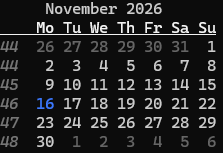

# Cal

Prints a calendar view of the current month to the terminal.

<p style="text-align:center">
    
</p>

## Setup

You can use the included Makefile if you have my [install](https://gitlab.com/lfknudsen/install) programme:

```
make
```

Or, you can execute
```
cargo build -r
```

and copy the new binary file in `target/release` to a location on your PATH.

## Usage

```
cal
```